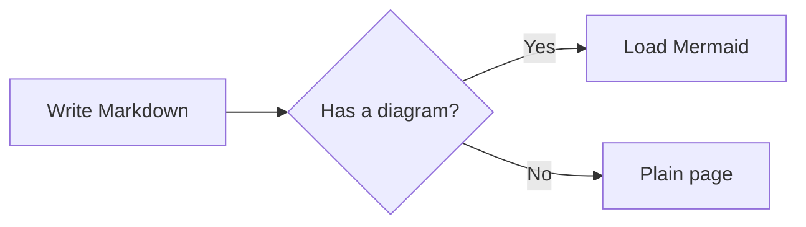

Put images next to your post in a [page bundle](https://gohugo.io/content-management/page-bundles/) and reference them with Markdown or the `resize-image` shortcode.
<!--more-->

## Markdown image

Images that are page resources get `loading="lazy"` and their intrinsic width and height.

## resize-image shortcode



## Mermaid diagram

Fence a code block with `mermaid` to draw a diagram. The theme loads Mermaid only on pages that contain one.

